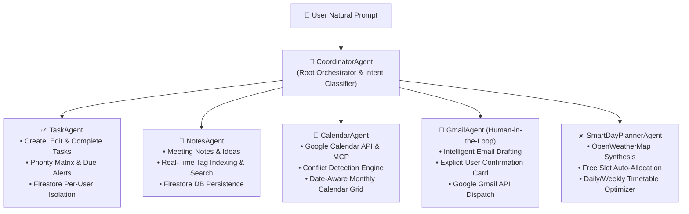

# Synaptix — Autonomous Multi-Agent Personal Productivity Assistant

<p align="center">
  <a href="https://synaptix-2cb9.onrender.com/">
    
  </a>
  <a href="https://github.com/apekshamanjunath-2005/synaptix">
    
  </a>
  
  
  
  
</p>

---

> 🚀 **Live Production Web App:** **[https://synaptix-2cb9.onrender.com/](https://synaptix-2cb9.onrender.com/)**  
> *Experience Synaptix in real-time with Google OAuth 2.0 or 1-Click Instant Guest Mode.*
> > **Note on Google Sign-In:** Synaptix uses Google's Gmail and Calendar OAuth scopes in unverified production mode (supporting up to 100 users). On your first sign-in, Google will display an *"App isn't verified"* warning—click **Advanced → Go to Synaptix (unsafe)** to grant permissions and test the live features. You can revoke access anytime from your [Google Account Permissions](https://myaccount.google.com/permissions).

---

## 💡 About Synaptix

### The Problem
Modern knowledge workers and students constantly juggle between multiple disconnected productivity silos: **Google Calendar** for meetings, **Gmail** for correspondence, **task managers** for action items, **note apps** for ideas, and **weather apps** for scheduling outdoor activities. 

Traditional single-prompt AI chatbots can write advice, but they cannot take deterministic real-world actions, detect calendar conflicts, or safely dispatch emails without risk of hallucination.

### The Solution
**Synaptix** is an autonomous, multi-agent personal productivity assistant that acts as your proactive **Chief of Staff**. Built with **Google Gemini 2.5 Flash** and the **Google ADK (Agent Development Kit)**, Synaptix unifies planning, communication, and execution into one cohesive, living workspace:

- 🧠 **Autonomous Intent Routing:** You talk naturally in plain English ("*I have a team sync tomorrow at 11 AM and need to prepare investor slides, draft an email to David with project notes, and plan my day*"). The **Coordinator Agent** automatically breaks down the prompt and dispatches sub-tasks to the appropriate specialist agents in parallel.
- 🛡️ **Human-in-the-Loop Safety:** Sensitive actions like sending emails never occur without explicit user verification. The **Gmail Agent** generates contextual preview cards (`Draft -> Approve -> Send`), ensuring total control.
- ☀️ **Holistic Day Planning:** The **Smart Day Planner** synthesizes pending tasks, calendar commitments, weather advisories, and your recurring routine blocks into an optimal, conflict-free schedule.
- 🎨 **Editorial Warm Dark Aesthetic:** Inspired by Lindy and Linear, the interface uses an Obsidian & Champagne-Gold palette (`#0D0D0F`, `#D4AF6A`) with glassmorphic top navigation, a gliding live agent marquee, and date-aware calendar grids.
- 👥 **Zero-Barrier Access:** Supports multi-user Google OAuth 2.0 with isolated Firestore databases, plus an instant 1-click **Guest Mode** for friction-free evaluation.

---

## 🏛 System Architecture & Multi-Agent Swarm

Synaptix delegates user requests across a root **Coordinator Agent** and **five specialist domain agents**:

```
                                ┌────────────────────────┐
                                │   User Natural Prompt  │
                                └───────────┬────────────┘
                                            │
                                            ▼
                                ┌────────────────────────┐
                                │    CoordinatorAgent    │
                                │   (Root Orchestrator)  │
                                └───────────┬────────────┘
         ┌────────────────┬─────────────┬───┴───┬─────────────┬────────────────┐
         │                │             │       │             │                │
         ▼                ▼             ▼       ▼             ▼                ▼
┌────────────────┐ ┌───────────────┐ ┌───────────────┐ ┌───────────────┐ ┌──────────────────────┐
│   TaskAgent    │ │  NotesAgent   │ │ CalendarAgent │ │  GmailAgent   │ │ SmartDayPlannerAgent │
├────────────────┤ ├───────────────┤ ├───────────────┤ ├───────────────┤ ├──────────────────────┤
│ • Create Tasks │ │ • Save Notes  │ │ • Book Events │ │ • Draft Email │ │ • Synthesize Schedule│
│ • List & Query │ │ • Fast Search │ │ • Conflicts   │ │ • HITL Approve│ │ • Priority Slotting  │
│ • Due Tracking │ │ • Tag Indexing│ │ • Day Agenda  │ │ • Send Emails │ │ • Weather Advisory   │
│ • Firestore DB │ │ • Firestore DB│ │ • Calendar MCP│ │ • Gmail API   │ │ • Multi-Agent Co-ord │
└────────────────┘ └───────────────┘ └───────────────┘ └───────────────┘ └──────────────────────┘
```



---

## ⚡ Specialist Agents Roster

| Agent | Responsibility | Underlying Tools & Integrations | Key Highlight |
| :--- | :--- | :--- | :--- |
| **🧠 Coordinator Agent** | Intent decomposition, classification & synthesis | Google ADK, Gemini 2.5 Flash | Automatically routes multi-domain requests to the correct specialists |
| **✅ Task Agent** | Task lifecycle, priority & due dates | Firebase Firestore, Local Simulator | Clean task filtering by priority (`high`, `medium`, `low`) & status |
| **📝 Notes Agent** | Idea capture, scratchpad & indexing | Firestore `notes` collection | Fast keyword search and categorized tag discovery |
| **📅 Calendar Agent** | Meeting bookings & agenda management | Google Calendar API, Model Context Protocol (MCP) | Automated timeslot conflict detection and interactive monthly calendar |
| **📧 Gmail Agent** | Contextual email drafting & delivery | Google Gmail API, OAuth `gmail.compose` | **Human-in-the-Loop**: never sends an email without explicit approval |
| **☀️ Smart Day Planner** | Day schedule & timetable optimization | OpenWeatherMap v2.5, Multi-Agent synthesis | Combines weather, tasks, and calendar events into conflict-free days |

---

## ✨ Key Features & Capabilities

- 🎨 **Editorial Warm Obsidian Design System:** Crafted with `Instrument Serif`, `Inter`, warm metallic champagne-gold (`#D4AF6A`), and deep obsidian surfaces (`#0D0D0F`, `#131316`).
- 🧭 **Floating Pill Navigation:** Centered, glassmorphic top navbar with quick access to AI Assistant, Tasks, Notes, Calendar, Gmail, Smart Planner, and Recent Chats slide-over drawer.
- 🎠 **Gliding Specialist Agent Marquee:** Horizontally continuous interactive marquee displaying live agent capabilities with pause/resume controls.
- 🛡️ **Human-in-the-Loop Email Approvals:** GmailAgent creates review cards showing recipient, subject, and body; dispatch requires explicit confirmation (`Approve and send draft <ID>`).
- 🗓️ **Date-Aware Monthly Calendar:** Interactive month view displaying scheduled event counts per date, conflict badges, and upcoming/past filters.
- ⏱️ **Editable Daily & Weekly Timetables:** Define recurring routine blocks (Deep Focus, Standup, Lunch, Wrap-up) with 1-click week replication and vector delete actions.
- 🔔 **Smart Reminders System:** Real-time in-app notification toasts, badge count indicators, and sound alerts for upcoming tasks, notes, and calendar events.
- 🔐 **Multi-User Google OAuth 2.0 & Instant Guest Mode:** Clean data isolation per user with an instant 1-click Guest Mode for frictionless testing.

---

## 🛠 Technology Stack

- **Backend Framework:** FastAPI, Uvicorn (ASGI), Pydantic v2, Pydantic-Settings
- **LLM & Agent Framework:** Google Gemini 2.5 Flash, Google ADK (`google-adk>=2.14.0`)
- **Protocol:** Model Context Protocol (`mcp>=1.0.0`)
- **Database:** Firebase Firestore (`firebase-admin`, `google-cloud-firestore`) + Local Offline Simulator
- **Google Integrations:** Google Calendar API, Google Gmail API (`google-api-python-client`, `google-auth-oauthlib`)
- **Weather Intelligence:** OpenWeatherMap API v2.5 (with offline fallback engine)
- **Authentication:** Google OAuth 2.0 with HTTP-only signed JWT session cookies (`PyJWT`, `cryptography`)
- **Frontend:** Pure Vanilla ES6+, CSS Custom Properties, Responsive Glassmorphism, Google Fonts (`Instrument Serif`, `Inter`, `JetBrains Mono`)
- **Deployment:** Render (PaaS), Docker (`python:3.12-slim`), Google Cloud Run

---

## 🚀 Quickstart & Local Setup

### 1. Prerequisites
- Python 3.12+
- Git

### 2. Clone & Install
```powershell
# Clone the repository
git clone https://github.com/apekshamanjunath-2005/synaptix.git
cd synaptix

# Create and activate virtual environment
python -m venv .venv
.\.venv\Scripts\Activate.ps1   # On Windows
# source .venv/bin/activate    # On macOS/Linux

# Install dependencies
pip install -r requirements.txt
```

### 3. Environment Variables
Copy the example environment configuration:
```powershell
cp .env.example .env
```
*(Synaptix works 100% out-of-the-box in Safe Zero-Cost Fallback Mode with local mock simulation even without external API keys).*

### 4. Run Development Server
```powershell
.\.venv\Scripts\python.exe -m uvicorn app.main:app --host 127.0.0.1 --port 8000 --reload
```

### 5. Access the Web Dashboard
- **Web UI:** [http://127.0.0.1:8000](http://127.0.0.1:8000)
- **Interactive OpenAPI Docs:** [http://127.0.0.1:8000/docs](http://127.0.0.1:8000/docs)
- **Health & Telemetry:** [http://127.0.0.1:8000/api/health](http://127.0.0.1:8000/api/health)

---

## 🌐 Production Deployment

### Live Render Deployment
Synaptix is deployed live on Render at:
🔗 **[https://synaptix-2cb9.onrender.com/](https://synaptix-2cb9.onrender.com/)**

#### Deploying Your Own Copy to Render:
1. Fork or push this repository to GitHub.
2. In the [Render Dashboard](https://dashboard.render.com/), click **New +** → **Blueprint** (or **Web Service**).
3. Connect your repository (Render will automatically detect `render.yaml`).
4. Set the following Environment Variables in Render:
   - `GEMINI_API_KEY`: Your Google AI Studio API key.
   - `GOOGLE_CLIENT_ID`: Google OAuth 2.0 Client ID.
   - `GOOGLE_CLIENT_SECRET`: Google OAuth 2.0 Client Secret.
   - `FIREBASE_CREDENTIALS_JSON`: *(Optional)* Full JSON string of your Firebase Service Account key.
   - `BASE_URL`: `https://your-service-name.onrender.com`
5. In [Google Cloud Console](https://console.cloud.google.com/apis/credentials), add:
   - **Authorized JavaScript origins:** `https://your-service-name.onrender.com`
   - **Authorized redirect URIs:** `https://your-service-name.onrender.com/auth/google/callback`

### Container Build (Docker):
```bash
docker build -t synaptix:latest .
docker run -p 8000:8000 synaptix:latest
```

---

## 🧪 Master Automated Test Suite

Synaptix is backed by **14 comprehensive test suites** covering all 8 milestone features and advanced multi-agent workflows.

```powershell
.\.venv\Scripts\python.exe tests/run_all_tests.py
```

### Automated Validation Breakdown:
1. ✅ **Milestone 1 — Foundation & Budget Guard:** `tests/verify_milestone1_comprehensive.py`
2. ✅ **Milestone 2 — Gemini Integration & RPM Burst Limiter:** `tests/test_milestone2.py`
3. ✅ **Milestone 3 — Google ADK Multi-Agent Orchestration:** `tests/test_milestone3.py`
4. ✅ **Milestone 4 — Firebase Firestore Tasks & Notes Layer:** `tests/test_milestone4.py`
5. ✅ **Milestone 5 — Google Calendar MCP Tool Provider:** `tests/test_milestone5.py`
6. ✅ **Milestone 6 — OpenWeatherMap Integration & Outdoor Engine:** `tests/test_milestone6.py`
7. ✅ **Milestone 7 — Smart Day Planner Multi-Agent Synthesis:** `tests/test_milestone7.py`
8. ✅ **Milestone 8 — UI & Glassmorphism Dashboard Experience:** `tests/test_milestone8.py`
9. ✅ **Gmail Agent — Human-in-the-Loop Email System:** `tests/test_gmail_agent.py`
10. ✅ **Multi-User OAuth — Google Login & Data Isolation:** `tests/test_multi_user_oauth.py`
11. ✅ **Smart Day Plans — Firestore Persistence & Isolation:** `tests/test_day_plans.py`
12. ✅ **Smart Reminders — Notes, Tasks & Due Alerts:** `tests/test_reminders.py`
13. ✅ **Persistent Multi-Session Chat History:** `tests/test_sessions.py`
14. ✅ **User Timetable & Date-Aware Calendar:** `tests/test_timetable_calendar.py`

---

## 📄 License

Distributed under the MIT License. See `LICENSE` for more information.

---

<p align="center">
  Crafted with precision by <b>Apeksha M</b> &bull; Built with <b>Google Gemini 2.5 Flash</b> & <b>Google ADK</b>
</p>
