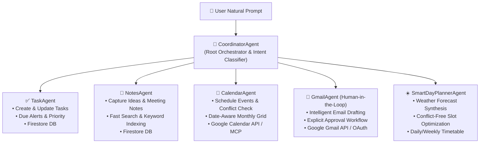

# Synaptix — Multi-Agent AI Personal Productivity Assistant

Synaptix is a production-grade, multi-agent AI personal productivity assistant built with **Google Gemini 2.5 Flash**, **Google ADK (Agent Development Kit)**, **FastAPI**, **Firebase Firestore**, **Google Calendar & Gmail APIs**, **Model Context Protocol (MCP)**, and **OpenWeatherMap**.

---

## 🏛 System Architecture & Multi-Agent Roster

Synaptix delegates user requests across a root coordinator and **five specialist agents** with Human-in-the-Loop safeguards:

```
                                ┌────────────────────────┐
                                │   User Natural Prompt  │
                                └───────────┬────────────┘
                                            │
                                            ▼
                                ┌────────────────────────┐
                                │    CoordinatorAgent    │
                                │   (Root Orchestrator)  │
                                └───────────┬────────────┘
         ┌────────────────┬─────────────┬───┴───┬─────────────┬────────────────┐
         │                │             │       │             │                │
         ▼                ▼             ▼       ▼             ▼                ▼
┌────────────────┐ ┌───────────────┐ ┌───────────────┐ ┌───────────────┐ ┌──────────────────────┐
│   TaskAgent    │ │  NotesAgent   │ │ CalendarAgent │ │  GmailAgent   │ │ SmartDayPlannerAgent │
├────────────────┤ ├───────────────┤ ├───────────────┤ ├───────────────┤ ├──────────────────────┤
│ • Create Tasks │ │ • Save Notes  │ │ • Book Events │ │ • Draft Email │ │ • Synthesize Schedule│
│ • List & Query │ │ • Fast Search │ │ • Conflicts   │ │ • HITL Approve│ │ • Priority Slotting  │
│ • Due Tracking │ │ • Tag Indexing│ │ • Day Agenda  │ │ • Send Emails │ │ • Weather Advisory   │
│ • Firestore DB │ │ • Firestore DB│ │ • Calendar MCP│ │ • Gmail API   │ │ • Multi-Agent Co-ord │
└────────────────┘ └───────────────┘ └───────────────┘ └───────────────┘ └──────────────────────┘
```



### Agent Specialization & Responsibilities

1. **Coordinator Agent:** Root intent analyzer, classification engine, and response synthesizer. Decomposes multi-intent prompts and routes tasks to specialized agents.
2. **Task Agent:** Full task lifecycle management (title, priority, due date, status) persisted in Firebase Firestore.
3. **Notes Agent:** Fast capture, tagging, and keyword indexing for meeting notes, ideas, and scratchpads.
4. **Calendar Agent:** Bidirectional Google Calendar integration via MCP and OAuth to book events, detect timeslot conflicts, and render monthly grids.
5. **Gmail Agent (Human-in-the-Loop):** Contextual email drafting, preview cards, explicit user confirmation (`Approve and send draft <ID>`), and direct dispatch via Google Gmail API.
6. **Smart Day Planner Agent:** Multi-agent synthesis combining pending tasks, calendar commitments, timetable blocks, and real-time weather to construct optimal daily schedules.

---

## 🛠 Technology Stack

- **Language:** Python 3.12
- **Agent Framework:** Google ADK (`google-adk>=2.14.0`)
- **LLM:** Google Gemini 2.5 Flash (`google-genai>=2.30.0`)
- **API Framework:** FastAPI, Uvicorn, Pydantic v2
- **Database:** Firebase Firestore (`firebase-admin`, `google-cloud-firestore`)
- **Google Integrations:** Google Calendar API, Google Gmail API (`google-api-python-client`, `google-auth-oauthlib`)
- **Protocol:** Model Context Protocol (`mcp>=2.3.0`)
- **HTTP Client:** HTTPX (`httpx>=0.28.1`)
- **Frontend:** Responsive Editorial Dark Workspace (Linear/Raycast/Lindy-inspired design system, vanilla ES6+, HTML5, CSS custom properties)
- **Containerization:** Docker (`python:3.12-slim`)
- **Cloud Deployment:** Google Cloud Run (Free Tier)

---

## 🚀 Quickstart & Setup

### 1. Prerequisites
- Python 3.12+
- Git

### 2. Virtual Environment Setup
```powershell
# Clone and navigate
git clone https://github.com/apekshamanjunath-2005/synaptix.git
cd synaptix

# Create & activate virtual environment
python -m venv .venv
.\.venv\Scripts\Activate.ps1

# Install dependencies
pip install -r requirements.txt
```

### 3. Environment Variables
Copy `.env.example` to `.env`:
```powershell
cp .env.example .env
```
*(Synaptix works 100% out-of-the-box in Safe Zero-Cost Fallback Mode even without external API keys).*

### 4. Run the Server
```powershell
.\.venv\Scripts\python.exe -m uvicorn app.main:app --host 127.0.0.1 --port 8000 --reload
```

### 5. Access the Web Dashboard
- **Web UI Dashboard:** [http://127.0.0.1:8000](http://127.0.0.1:8000)
- **Interactive Swagger Docs:** [http://127.0.0.1:8000/docs](http://127.0.0.1:8000/docs)
- **System Health & Telemetry:** [http://127.0.0.1:8000/api/health](http://127.0.0.1:8000/api/health)

---

## 🧪 Master Automated Test Suite

Synaptix comes with **14 comprehensive automated test suites** covering all milestones and production features:

```powershell
.\.venv\Scripts\python.exe tests/run_all_tests.py
```

### Test Suite Breakdown:
1. **Milestone 1 — Foundation & Budget Guard:** `tests/verify_milestone1_comprehensive.py`
2. **Milestone 2 — Gemini Integration & RPM Burst Limiter:** `tests/test_milestone2.py`
3. **Milestone 3 — Google ADK Multi-Agent Orchestration:** `tests/test_milestone3.py`
4. **Milestone 4 — Firebase Firestore Tasks & Notes Layer:** `tests/test_milestone4.py`
5. **Milestone 5 — Google Calendar MCP Tool Provider:** `tests/test_milestone5.py`
6. **Milestone 6 — OpenWeatherMap Integration & Outdoor Engine:** `tests/test_milestone6.py`
7. **Milestone 7 — Smart Day Planner Multi-Agent Synthesis:** `tests/test_milestone7.py`
8. **Milestone 8 — UI & Glassmorphism Dashboard Experience:** `tests/test_milestone8.py`
9. **Gmail Agent — Human-in-the-Loop Email System:** `tests/test_gmail_agent.py`
10. **Multi-User OAuth — Google Login & Data Isolation:** `tests/test_multi_user_oauth.py`
11. **Smart Day Plans — Firestore Persistence & Isolation:** `tests/test_day_plans.py`
12. **Smart Reminders — Notes, Tasks & Due Alerts:** `tests/test_reminders.py`
13. **Persistent Multi-Session Chat History:** `tests/test_sessions.py`
14. **User Timetable & Date-Aware Calendar:** `tests/test_timetable_calendar.py`

---

## 🐳 Docker & Cloud Run Deployment

### Local Container Build:
```bash
docker build -t synaptix:latest .
docker run -p 8000:8000 synaptix:latest
```

### Zero-Cost Google Cloud Run Deployment:
See the detailed guide in [docs/deployment_cloud_run.md](docs/deployment_cloud_run.md).
```bash
gcloud run deploy synaptix \
  --source . \
  --region us-central1 \
  --allow-unauthenticated \
  --min-instances 0 \
  --max-instances 1 \
  --concurrency 40 \
  --cpu 1 \
  --memory 512Mi \
  --cpu-throttling
```
