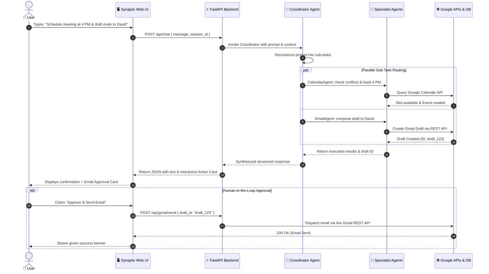

# 🌟 Synaptix — The Complete Beginner-to-Expert Guide & Architecture Notes

> **"What if your calendar, task manager, notes app, email inbox, and daily timetable weren't five separate tabs—but five expert specialists sitting in the same room, coordinated by an intelligent Chief of Staff who speaks plain English?"**

---

## 📑 Table of Contents
1. [Executive Summary: What is Synaptix?](#1-executive-summary-what-is-synaptix)
2. [AI Agents Explained for Complete Beginners](#2-ai-agents-explained-for-complete-beginners)
   - [What is an AI?](#what-is-an-ai)
   - [What is a Large Language Model (LLM)?](#what-is-a-large-language-model-llm)
   - [LLM vs. AI Agent: The Critical Difference](#llm-vs-ai-agent-the-critical-difference)
   - [What is a Multi-Agent System? The "Chief of Staff" Analogy](#what-is-a-multi-agent-system-the-chief-of-staff-analogy)
3. [The Problem Synaptix Solves](#3-the-problem-synaptix-solves)
   - [The Modern "Productivity Fragmentation" Crisis](#the-modern-productivity-fragmentation-crisis)
   - [Why Standard Chatbots (ChatGPT, Claude) Can't Solve This Alone](#why-standard-chatbots-chatgpt-claude-cant-solve-this-alone)
4. [How Synaptix Works: Step-by-Step Architecture](#4-how-synaptix-works-step-by-step-architecture)
   - [The Core Workflow: From Intent to Real-World Action](#the-core-workflow-from-intent-to-real-world-action)
   - [System Architecture Diagram](#system-architecture-diagram)
5. [The Specialist Agent Roster](#5-the-specialist-agent-roster)
   - [🧠 The Coordinator Agent (Root Orchestrator)](#-the-coordinator-agent-root-orchestrator)
   - [✅ Task Agent (Action Items & Due Dates)](#-task-agent-action-items--due-dates)
   - [📝 Notes Agent (Meeting Scribe & Knowledge Base)](#-notes-agent-meeting-scribe--knowledge-base)
   - [📅 Calendar Agent (Schedules & Conflict Engine)](#-calendar-agent-schedules--conflict-engine)
   - [📧 Gmail Agent (Human-in-the-Loop Email Dispatch)](#-gmail-agent-human-in-the-loop-email-dispatch)
   - [☀️ Smart Day Planner Agent (Daily Synthesis & Weather Optimizer)](#️-smart-day-planner-agent-daily-synthesis--weather-optimizer)
6. [Critical Design Principles & Safety](#6-critical-design-principles--safety)
   - [Human-in-the-Loop (HITL): Why Safety Matters](#human-in-the-loop-hitl-why-safety-matters)
   - [Zero-Cost Free-Tier Architecture & Budget Guard](#zero-cost-free-tier-architecture--budget-guard)
   - [Multi-User Google OAuth 2.0 & Instant Guest Mode](#multi-user-google-oauth-20--instant-guest-mode)
7. [Underlying Technologies & Integrations](#7-underlying-technologies--integrations)
   - [Google Gemini 2.5 Flash & Google ADK](#google-gemini-25-flash--google-adk)
   - [Model Context Protocol (MCP)](#model-context-protocol-mcp)
   - [Firebase Firestore Cloud Database](#firebase-firestore-cloud-database)
   - [Google Calendar & Gmail REST APIs](#google-calendar--gmail-rest-apis)
   - [OpenWeatherMap v2.5 API](#openweathermap-v25-api)
8. [The UI/UX Experience: Editorial Warm Dark Design](#8-the-uiux-experience-editorial-warm-dark-design)
   - [Design Philosophy: Lindy & Obsidian Aesthetics](#design-philosophy-lindy--obsidian-aesthetics)
   - [Interactive Hero-to-Docked Transition](#interactive-hero-to-docked-transition)
   - [Gliding Agent Directory Carousel](#gliding-agent-directory-carousel)
   - [Seamless View Switching & Navigation Safeguards](#seamless-view-switching--navigation-safeguards)
9. [Real-World Engineering Challenges & How They Were Solved](#9-real-world-engineering-challenges--how-they-were-solved)
   - [Challenge 1: Render Free-Tier SMTP Port Blocking](#challenge-1-render-free-tier-smtp-port-blocking)
   - [Challenge 2: Ephemeral Cloud Storage & OAuth Token Refresh](#challenge-2-ephemeral-cloud-storage--oauth-token-refresh)
   - [Challenge 3: Error Visibility & Traceback Surfacing](#challenge-3-error-visibility--traceback-surfacing)
   - [Challenge 4: UI Navigation, Scroll Offsets & Mobile Stacking](#challenge-4-ui-navigation-scroll-offsets--mobile-stacking)
10. [Step-by-Step Installation & Local Run Guide](#10-step-by-step-installation--local-run-guide)
11. [Production Deployment Guide (Render & Cloud)](#11-production-deployment-guide-render--cloud)
12. [Glossary of Terms for Non-Technical Readers](#12-glossary-of-terms-for-non-technical-readers)

---

## 1. Executive Summary: What is Synaptix?

**Synaptix** is an autonomous, multi-agent personal productivity assistant. It acts as an intelligent **Chief of Staff** that helps students, professionals, and teams manage their daily lives through natural conversation.

Instead of manually switching back and forth between Google Calendar, Gmail, task trackers (like Todoist or Trello), notes apps (like Notion or Apple Notes), and weather forecasts, **you simply speak to Synaptix in plain human language**:

> *"I have a project review meeting tomorrow at 3 PM with David. Please add it to my calendar, create a task to prepare the slide deck by noon, take a note of our talking points, draft an email to David with the meeting agenda, and check tomorrow's weather to see if I can walk to the office."*

In a few seconds, Synaptix:
1. Understands your sentence and breaks it down into 5 independent sub-tasks.
2. Directs the **Calendar Agent** to book the meeting and check for schedule conflicts.
3. Directs the **Task Agent** to create a prioritized task with a deadline in your database.
4. Directs the **Notes Agent** to save your talking points and tag them for instant search.
5. Directs the **Gmail Agent** to prepare a clean email draft for you to review and approve.
6. Directs the **Planner Agent** to check tomorrow's weather forecast and organize your day's schedule.

All of this happens inside a single, unified web app with an editorial dark-themed interface.

---

## 2. AI Agents Explained for Complete Beginners

If you have never worked with artificial intelligence or code before, this section explains all the core concepts using simple real-world analogies.

### What is an AI?
An **Artificial Intelligence (AI)** is computer software that can perform tasks that usually require human intelligence—such as understanding speech, recognizing images, making decisions, or translating languages.

### What is a Large Language Model (LLM)?
A **Large Language Model (LLM)**—like **Google Gemini**, ChatGPT, or Claude—is a powerful AI trained on billions of written sentences. It is exceptionally good at understanding text and generating human-like responses.

> 💡 **Analogy:** Think of an LLM as a brilliant person sitting in a closed room with only a typewriter. They have read the entire library of human knowledge. If you slip a letter under the door asking a question, they will type out a well-worded answer.

### LLM vs. AI Agent: The Critical Difference
While an LLM can write beautifully, **a raw LLM cannot take action in the real world**:
* If you tell ChatGPT: *"Book a meeting on my calendar for 3 PM,"* it can write back: *"Sure! I recommend scheduling your meeting at 3 PM."* But it **cannot actually open your Google Calendar** or book anything. It has no hands, no tools, and no connection to your real tools.

An **AI Agent** is an LLM that has been given **Tools**, **Memory**, and the **Ability to Take Action**:

| Capability | Standard LLM (Chatbot) | AI Agent (Synaptix) |
| :--- | :--- | :--- |
| **Input** | Reads text prompt | Reads text prompt & context |
| **Output** | Writes text back | Executes code & calls real APIs |
| **Database** | Cannot save or load user data | Reads & writes to secure cloud databases |
| **Calendar** | Can only talk about dates | Queries & schedules live Google Calendar events |
| **Email** | Can only compose a sample letter | Previews and dispatches real Gmail messages |
| **Decision Loop** | Single-shot response | Loops: *Observe → Plan → Act → Verify* |

> 🤖 **Analogy:**  
> * **Standard LLM:** A knowledgeable advisor who can give advice, but cannot leave their chair.  
> * **AI Agent:** A personal assistant who hears your request, picks up the phone, logs into your calendar, writes the database entry, and drafts the email on your behalf.

### What is a Multi-Agent System? The "Chief of Staff" Analogy
In software, trying to make a single AI agent do *everything* leads to mistakes, confusion, and hallucinations. A single prompt trying to handle email, database records, weather forecasting, and calendar scheduling gets overwhelmed.

Synaptix uses a **Multi-Agent Swarm**:
* **The Coordinator Agent (The Chief of Staff):** Listens to you, understands your goals, and decides who in the team should handle which part.
* **Specialist Agents (Department Heads):**
  * **Task Specialist:** Manages to-do items and due dates.
  * **Notes Specialist:** Manages thoughts, documentation, and tags.
  * **Calendar Specialist:** Manages dates, hours, and meetings.
  * **Email Specialist:** Handles correspondence.
  * **Planner Specialist:** Optimizes your daily routine based on your schedule and weather.

```
                    ┌────────────────────────┐
                    │      You (The User)    │
                    └───────────┬────────────┘
                                │ "Plan my day & draft an email"
                                ▼
                    ┌────────────────────────┐
                    │    Coordinator Agent   │
                    │   (Chief of Staff)     │
                    └───────────┬────────────┘
         ┌──────────────┬───────┴───────┬──────────────┐
         ▼              ▼               ▼              ▼
   ┌───────────┐  ┌───────────┐   ┌───────────┐  ┌───────────┐
   │ Task Spec │  │ Note Spec │   │ Cal Spec  │  │ Mail Spec │
   └───────────┘  └───────────┘   └───────────┘  └───────────┘
```

---

## 3. The Problem Synaptix Solves

### The Modern "Productivity Fragmentation" Crisis
Every day, the average knowledge worker or student uses 4 to 8 different apps just to stay organized:
1. **Google Calendar** for meetings.
2. **Gmail** or Outlook for messages.
3. **Todoist, Trello, or Jira** for tasks.
4. **Notion, Obsidian, or Apple Notes** for thoughts and meeting minutes.
5. **Weather app** to check if travel is feasible.
6. **Alarms/Reminders** for time-sensitive alerts.

**The result:**
* Constant **context switching** (losing up to 20 minutes of focus each time you switch tools).
* **Double bookings** and calendar overlaps because your task list doesn't know about your meetings.
* **Forgotten follow-ups**: You finish a meeting, forget to draft the promised email, and fail to log the next steps in your task tracker.

### Why Standard Chatbots Can't Solve This Alone
When people try to use standard chatbots (like ChatGPT) to organize their lives:
1. **No Real-World Execution:** They generate a Markdown schedule, but the user still has to manually copy-paste every event into Google Calendar.
2. **Hallucination Risk:** A chatbot might falsely claim: *"I have sent that email for you!"* even though no email was actually sent.
3. **Accidental Actions:** If an AI blindly sends emails on your behalf without your approval, it could send an embarrassing message to a client or colleague.

**Synaptix fixes this** by combining:
* Direct integration with real Google services.
* Deterministic cloud database storage.
* Strict **Human-in-the-Loop** verification before any sensitive action is taken.

---

## 4. How Synaptix Works: Step-by-Step Architecture

### The Core Workflow: From Intent to Real-World Action

Here is what happens behind the scenes when a user sends a message:



### System Architecture Breakdown

1. **User Request Reception:** The web frontend sends the user's prompt, session history, and timezone to `/api/chat`.
2. **Intent Classification & Routing:** The **Coordinator Agent** (powered by **Google Gemini 2.5 Flash** and the **Google ADK**) analyzes the sentence. It determines which domain specialists are needed.
3. **Autonomous Tool Calling:**
   * If tasks are mentioned, the `TaskAgent` calls `add_task()` against Firebase Firestore.
   * If notes are mentioned, the `NotesAgent` calls `create_note()`.
   * If dates or meetings are mentioned, the `CalendarAgent` calls the Google Calendar MCP tool, checks for overlapping events, and books the slot.
   * If emails are mentioned, the `GmailAgent` calls `create_draft()`.
   * If daily scheduling is needed, the `SmartDayPlannerAgent` queries live weather and merges tasks with free calendar slots.
4. **Safe Response Delivery:** The Coordinator aggregates all answers into an editorial, polite summary. If an email was drafted, it includes a visual **Human-in-the-Loop card** so the user can verify the subject, recipient, and body before hitting send.

---

## 5. The Specialist Agent Roster

```
┌────────────────────────────────────────────────────────────────────────┐
│                          SYNAPTIX AGENT SWARM                          │
├─────────────────────┬────────────────────────────────┬─────────────────┤
│ Agent Name          │ Primary Duty                   │ Integration     │
├─────────────────────┼────────────────────────────────┼─────────────────┤
│ 🧠 Coordinator      │ Root routing & synthesis       │ Google ADK      │
│ ✅ Task Agent       │ Priorities, due dates & status │ Firestore       │
│ 📝 Notes Agent      │ Meeting records & tag search   │ Firestore       │
│ 📅 Calendar Agent   │ Events & conflict detection    │ Google Calendar │
│ 📧 Gmail Agent      │ Email drafts & safe delivery   │ Gmail REST API  │
│ ☀️ Day Planner      │ Day optimization & weather     │ OpenWeatherMap  │
└─────────────────────┴────────────────────────────────┴─────────────────┘
```

### 🧠 The Coordinator Agent (Root Orchestrator)
* **Role:** The front-desk executive who listens to everything.
* **How it works:** It inspects every incoming prompt. If the prompt is simple (*"What's on my to-do list today?"*), it sends it directly to the Task Agent. If the prompt is a complex compound sentence (*"Plan my day, set a high-priority task to buy groceries, and email Sarah that I will be late"*), it splits the sentence and activates the Planner, Task, and Gmail agents simultaneously.

### ✅ Task Agent (Action Items & Due Dates)
* **Role:** Personal project manager.
* **Capabilities:**
  * Creates tasks with priority levels (`high`, `medium`, `low`).
  * Attaches due dates and times.
  * Filters tasks by status (`pending`, `completed`).
  * Persists records per-user in Firebase Firestore so your tasks stay safe across devices.

### 📝 Notes Agent (Meeting Scribe & Knowledge Base)
* **Role:** Personal secretary and digital notebook.
* **Capabilities:**
  * Takes notes from meetings, lectures, or spontaneous ideas.
  * Automatically suggests tags (e.g., `#finance`, `#meeting`, `#project-x`).
  * Performs instant keyword searching over saved notes.

### 📅 Calendar Agent (Schedules & Conflict Engine)
* **Role:** Scheduling coordinator.
* **Capabilities:**
  * Integrates with Google Calendar via the **Model Context Protocol (MCP)**.
  * **Conflict Detection Engine:** Before booking any event, it checks your existing calendar events. If you already have a meeting at that hour, it flags: *"⚠️ Conflict detected: You already have 'Sprint Review' scheduled from 2:00 PM to 3:00 PM."*
  * Feeds data to the interactive monthly calendar view in the frontend.

### 📧 Gmail Agent (Human-in-the-Loop Email Dispatch)
* **Role:** Executive communications assistant.
* **Capabilities:**
  * Understands email intent (*"Tell David the slides are ready and ask if 10 AM works"*).
  * Composes a professional subject and body.
  * **Crucial Safety Rule:** It **never** sends an email immediately. It creates a draft and returns an interactive preview card to the chat with two options:
    1. **"Approve & Send Draft"** (1-click trigger).
    2. **Edit Prompt** (letting you tweak the text before sending).

### ☀️ Smart Day Planner Agent (Daily Synthesis & Weather Optimizer)
* **Role:** Operations strategist.
* **Capabilities:**
  * Looks at your **Google Calendar events**, your **pending high-priority tasks**, your **recurring routine timetable** (e.g., lunch, gym, deep focus), and **live outdoor weather**.
  * If it rains, it warns you not to schedule outdoor walks.
  * Merges everything into a cohesive, hour-by-hour schedule designed to maximize productivity without causing burnout.

---

## 6. Critical Design Principles & Safety

### Human-in-the-Loop (HITL): Why Safety Matters
In autonomous systems, the biggest danger is an AI taking irreversible actions without human oversight.

```
AI generates email ──► [ STOP & SHOW REVIEW CARD ] ──► User clicks "Approve" ──► Sent
                              │
                              └──► User modifies prompt ──► Updated Draft
```

* **No Unsolicited Emails:** The `GmailAgent` only creates a draft in your inbox first.
* **Visual Audit:** The user sees recipient, subject line, and the full body.
* **Explicit Trigger:** The email is only dispatched over Google's REST API when the user explicitly clicks the approve button or types *"Approve and send draft [ID]"*.

### Zero-Cost Free-Tier Architecture & Budget Guard
Synaptix was engineered from day one to run **100% free** without unexpected cloud bills:
1. **Gemini 2.5 Flash Free Tier:** Google AI Studio offers generous free daily API limits.
2. **Budget Guard Rate Limiter:** Built directly into the backend (`app/core/budget_guard.py`), it monitors RPM (requests per minute) and daily token usage. If the limit is reached, it returns HTTP 429 with a polite warning rather than racking up credit card charges.
3. **Safe Offline Fallbacks:**
   * If Google Calendar credentials are not provided, it falls back to a simulated in-memory calendar.
   * If Firebase credentials are not provided, it falls back to an offline local JSON database simulator (`.firestore_local.json`).
   * If OpenWeatherMap API is unavailable, it uses a zero-cost heuristic weather generator.

### Multi-User Google OAuth 2.0 & Instant Guest Mode
* **Google OAuth 2.0:** Users can sign in with their Google account. Each user receives an isolated data partition in Firestore (`users/{userId}/tasks`, `users/{userId}/notes`), ensuring no data leaks between different users.
* **1-Click Guest Mode:** Evaluators and testers can click *"Guest Mode"* in the top navigation to instantly try out all features without signing in. Guest data is kept completely private in the session.

---

## 7. Underlying Technologies & Integrations

```
┌────────────────────────────────────────────────────────────┐
│                    TECHNOLOGY STACK                        │
├─────────────────────┬──────────────────────────────────────┤
│ Layer               │ Technology                           │
├─────────────────────┼──────────────────────────────────────┤
│ Backend Framework   │ FastAPI (Python 3.12, Uvicorn ASGI)  │
│ LLM & Agent Engine  │ Google Gemini 2.5 Flash & Google ADK │
│ Protocol            │ Model Context Protocol (MCP 1.0)     │
│ Cloud Database      │ Firebase Cloud Firestore             │
│ Email & Calendar    │ Google Calendar API, Gmail REST API  │
│ Weather             │ OpenWeatherMap API v2.5              │
│ Security & Auth     │ Google OAuth 2.0 & JWT Cookies       │
│ Frontend            │ Vanilla ES6+, CSS3 Glassmorphism     │
│ Cloud Hosting       │ Render PaaS & Docker                 │
└─────────────────────┴──────────────────────────────────────┘
```

* **FastAPI:** High-performance, asynchronous Python web framework providing OpenAPI autodocumentation (`/docs`), background task workers, and Pydantic v2 data validation.
* **Google ADK (Agent Development Kit):** Framework for orchestrating autonomous agents, passing tool definitions to Gemini, and handling multi-turn conversation memory.
* **Model Context Protocol (MCP):** Open protocol standard allowing AI agents to securely connect to external tools (such as calendar servers, file systems, and web search engines) through structured interfaces.

---

## 8. The UI/UX Experience: Editorial Warm Dark Design

### Design Philosophy: Lindy & Obsidian Aesthetics
Unlike generic AI dashboards that use sterile corporate blue or harsh bright white, Synaptix uses a tailored **editorial warm-dark palette**:
* **Background:** Deep Obsidian (`#0D0D0F`, `#131316`) with living GPU-accelerated drifting ambient light orbs.
* **Typography:** Premium serif headings (`Instrument Serif`) combined with clean geometric sans (`Inter`) and monospace code (`JetBrains Mono`).
* **Accents:** Warm champagne-gold sparkles (`#D4AF6A`) and glassmorphic translucent panels with subtle borders (`rgba(255, 255, 255, 0.08)`).

### Interactive Hero-to-Docked Transition
* **Home State (Hero):** When you open Synaptix, you see the grand editorial greeting (*"Meet Synaptix, get it done"*), the floating composer card, and the horizontally gliding specialist agent directory.
* **Docked State (Chat):** When you send a message, the greeting smoothly transitions away, docking the conversation stream to full view.
* **Back to Home:** A dedicated **"← Back to Home"** button, clicking the brand logo, or pressing the browser back button instantly restores the full landing hero and directory.

### Gliding Agent Directory Carousel
Below the composer card sits a continuous horizontal marquee showcasing the live capabilities of the 5 specialist agents. Users can pause, resume, or click any agent card to jump straight into that specialist's dedicated dashboard view.

---

## 9. Real-World Engineering Challenges & How They Were Solved

During production deployment to Render, several real-world cloud engineering challenges were diagnosed and resolved:

### Challenge 1: Render Free-Tier SMTP Port Blocking
* **Symptom:** Sending emails initially failed in production on Render with connection timeouts (`Errno 111 Connection refused` or `timeout`).
* **Root Cause:** Render's free tier (and most cloud container providers) strictly blocks outbound SMTP ports (`25`, `465`, and `587`) to prevent spam relays.
* **Solution:** We completely eliminated legacy `smtplib` and transitioned to the official **Google Gmail REST API v1** over HTTPS (port `443`), which is never blocked by cloud hosts.

### Challenge 2: Ephemeral Cloud Storage & OAuth Token Refresh
* **Symptom:** On cloud platforms like Render, local files like `token.json` or `credentials.json` are ephemeral—they get wiped every time a new git commit triggers a container rebuild.
* **Root Cause:** Hardcoded file paths (`open("token.json")`) crash when running inside a stateless Docker container.
* **Solution:** Refactored `google_auth_helper.py` to read credentials directly from the `GOOGLE_TOKEN_JSON` environment variable. Furthermore, an **in-memory token refresher** automatically detects expired tokens, refreshes them with Google's OAuth servers using the `refresh_token`, and keeps the live service running without user interruption.

### Challenge 3: Error Visibility & Traceback Surfacing
* **Symptom:** When a backend failure occurred, the user interface simply displayed: *"Synaptix AI: ⚠️ An unexpected error occurred. Please try again."*
* **Root Cause:** The FastAPI endpoint caught unhandled exceptions with a generic 500 handler, and `app.js` masked detailed errors.
* **Solution:** Added structured Python `logging` with `exc_info=True` to print complete stack traces into Render logs, and updated `app.js` to surface the real error details so issues can be diagnosed in seconds.

### Challenge 4: UI Navigation, Scroll Offsets & Mobile Stacking
* **Symptom:** On mobile screens (375px), "Synaptix AI" and "AI Assistant" text collided in the navbar, clicking "How it works" didn't scroll properly when inside docked chat, and there was no way to return to the home screen from an active conversation.
* **Solution:**
  * Added responsive CSS media queries: swapped "AI Assistant" to "Chat" on tablets, and hid redundant badges on phones `<= 480px`.
  * Updated the "How it works" link to programmatically exit docked mode, activate the home tab, and smoothly scroll `.main-content` directly to the section accounting for the fixed top navbar height.
  * Added the active chat header toolbar (`#chatBackBtn`) and browser history `popstate` support to return to Home at any time.

---

## 10. Step-by-Step Installation & Local Run Guide

### 1. System Requirements
* Python 3.12 or higher
* Git
* A modern web browser (Chrome, Edge, Safari, Firefox)

### 2. Clone the Repository
```powershell
git clone https://github.com/apekshamanjunath-2005/synaptix.git
cd synaptix
```

### 3. Set Up Virtual Environment
```powershell
# Windows PowerShell
python -m venv .venv
.\.venv\Scripts\Activate.ps1

# macOS / Linux
python3 -m venv .venv
source .venv/bin/activate
```

### 4. Install Dependencies
```powershell
pip install -r requirements.txt
```

### 5. Configure Environment Variables
Copy `.env.example` to `.env`:
```powershell
cp .env.example .env
```
Open `.env` and configure:
```ini
# Google Gemini API Key (Get free from https://aistudio.google.com/)
GEMINI_API_KEY=your_gemini_api_key_here

# Google OAuth 2.0 (For Google Sign-In, Calendar & Gmail)
GOOGLE_CLIENT_ID=your_client_id.apps.googleusercontent.com
GOOGLE_CLIENT_SECRET=your_client_secret

# OpenWeatherMap (Optional - free from https://openweathermap.org/)
OPENWEATHERMAP_API_KEY=your_weather_key

# Host & Port Settings
HOST=127.0.0.1
PORT=8000
BASE_URL=http://localhost:8000
```
*(Note: If you leave keys blank, Synaptix will run safely in local mock simulation mode).*

### 6. Run the Application
```powershell
.\.venv\Scripts\python.exe -m uvicorn app.main:app --host 127.0.0.1 --port 8000 --reload
```
Open your browser and navigate to:
* **Web Application:** `http://127.0.0.1:8000`
* **Swagger API Documentation:** `http://127.0.0.1:8000/docs`
* **Health Check:** `http://127.0.0.1:8000/api/health`

### 7. Run the Automated Test Suite
To verify that all 14 test suites pass:
```powershell
.\.venv\Scripts\python.exe tests/run_all_tests.py
```

---

## 11. Production Deployment Guide (Render & Cloud)

Synaptix is deployed live at: **[https://synaptix-2cb9.onrender.com/](https://synaptix-2cb9.onrender.com/)**

### Deploying Your Own Instance on Render:
1. **Push your code to GitHub.**
2. Go to the [Render Dashboard](https://dashboard.render.com/) and click **New +** → **Web Service**.
3. Select your repository. Render will automatically detect the Python environment and `render.yaml`.
4. Add the following **Environment Variables** in Render Settings:
   * `GEMINI_API_KEY`: Your Gemini API key.
   * `GOOGLE_CLIENT_ID`: Your Google OAuth Client ID.
   * `GOOGLE_CLIENT_SECRET`: Your Google OAuth Client Secret.
   * `GOOGLE_TOKEN_JSON`: Full JSON string of your authorized user token (for persistent Gmail/Calendar access across redeploys).
   * `BASE_URL`: `https://your-service-name.onrender.com`
5. Update your **Google Cloud Console Credentials**:
   * Add `https://your-service-name.onrender.com` to **Authorized JavaScript origins**.
   * Add `https://your-service-name.onrender.com/auth/google/callback` to **Authorized redirect URIs**.

---

## 12. Glossary of Terms for Non-Technical Readers

* **API (Application Programming Interface):** A digital bridge that allows two software programs to communicate with each other (e.g., allowing Synaptix to talk to Google Calendar).
* **Autonomous Agent:** A computer program powered by an AI model that can break down goals, plan multi-step actions, and use software tools without needing a human to guide every individual keystroke.
* **Coordinator Agent:** The central "orchestrator" or "traffic cop" in a multi-agent system that listens to the user and decides which specialist agent should do the work.
* **Deterministic:** A process that always yields predictable, verified results (such as saving a task to a database), unlike creative generative text which can vary.
* **Docker:** A software platform that packages an application and all its dependencies into a standardized container, guaranteeing it runs identically on any computer or cloud server.
* **Ephemeral Storage:** Temporary computer memory or hard drive space on cloud hosting platforms that gets wiped and recreated fresh every time a server restarts or redeploys.
* **FastAPI:** A modern, extremely fast Python framework used to build backend APIs and serve web pages.
* **Firebase Firestore:** A scalable, real-time cloud database provided by Google Cloud to store user data (like tasks and notes) securely.
* **Human-in-the-Loop (HITL):** A safety design pattern where an AI prepares an action (like writing an email), but pauses and requires a real human to click "Approve" before the action is executed.
* **LLM (Large Language Model):** An artificial intelligence neural network trained on vast amounts of text that can understand and generate human language (e.g., Google Gemini).
* **Model Context Protocol (MCP):** An open standard that enables AI models to interact with local and remote data sources and tools in a standardized format.
* **OAuth 2.0:** A secure authorization protocol that allows you to give an application permission to access your Google account (like Calendar or Gmail) without sharing your password.
* **PaaS (Platform as a Service):** A cloud hosting service (like Render) that automatically builds, deploys, and scales web applications directly from code repositories.
* **REST API:** A standard architectural style for exchanging data over the web using HTTP methods (GET, POST, PUT, DELETE).
* **Token (OAuth):** A secure digital key provided by an identity service (like Google) that proves an application has been granted permission to perform actions on behalf of a user.

---

<p align="center">
  <b>Synaptix</b> &bull; Built with Google Gemini 2.5 Flash, Google ADK & FastAPI<br/>
  <i>Engineered for elegance, efficiency, and zero-cost accessibility.</i>
</p>
